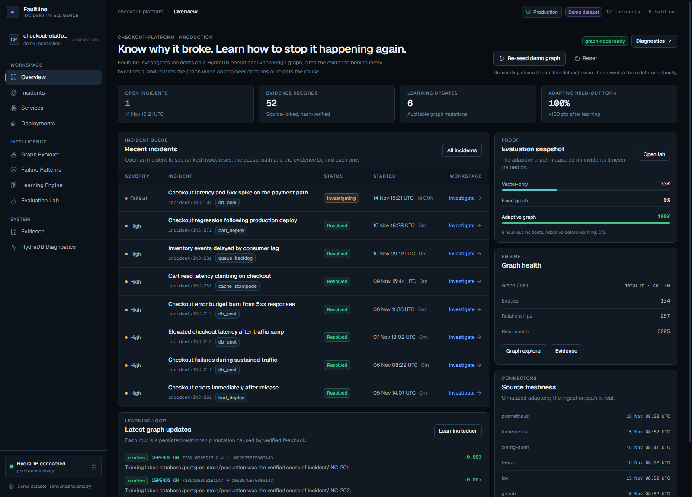
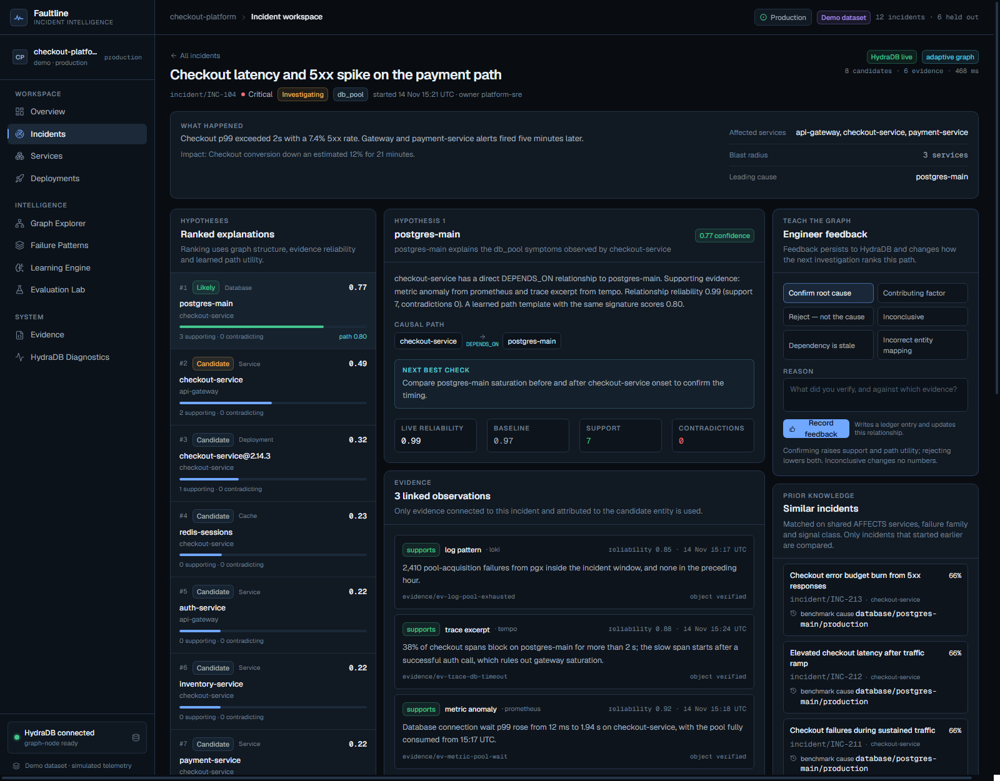
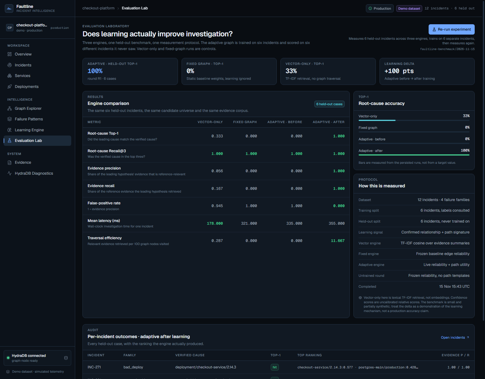
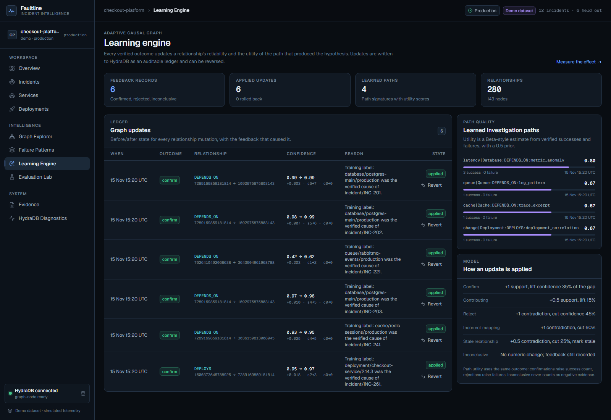
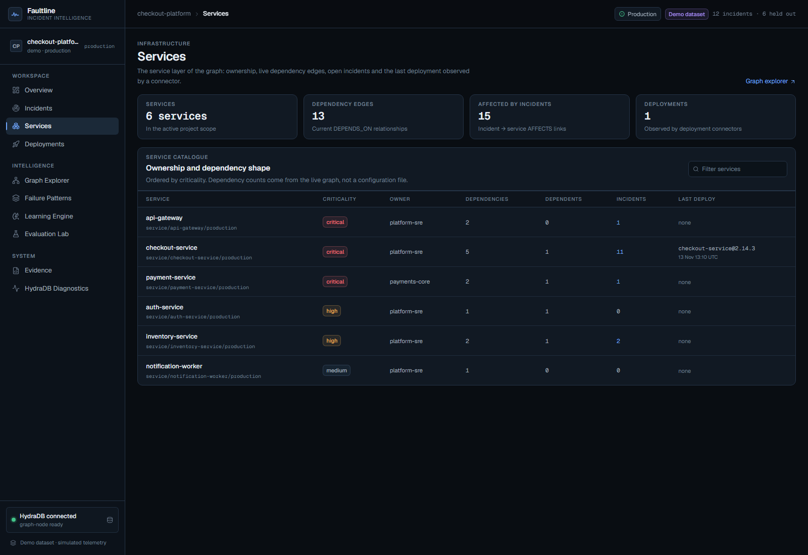
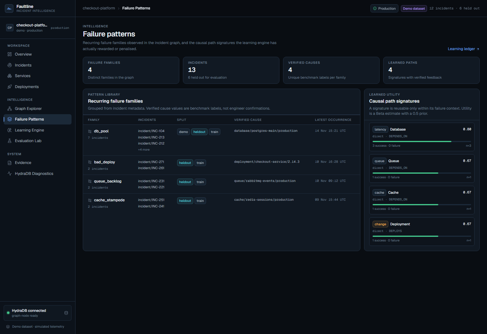

# Faultline

**Know why it broke. Learn how to stop it happening again.**

Faultline is a self-improving incident intelligence platform built on the
[self-hosted HydraDB](https://github.com/hydra-db/hydradb) graph engine. It
investigates production incidents on a connected operational knowledge graph,
cites the evidence behind every hypothesis, and rewires that graph when an
engineer confirms or rejects the cause.

The next investigation is ranked by what the last one taught it.

---

## The problem

Production failures are diagnosed across a dozen disconnected systems: metrics,
logs, traces, deployments, commits, Kubernetes events, previous incidents and the
memory of whoever was on call. Engineers reconstruct the causal chain by hand.
The first alert is usually a symptom several hops from the cause.

Search and vector retrieval can find text that *looks* similar. They cannot tell
you that this checkout service depends on that database, that the dependency was
confirmed by traces an hour ago, or that a previous incident with the same
topology had a verified cause.

## What Faultline does

1. **Investigates on the graph.** A bounded traversal from the incident finds
   affected services, dependencies, deployments and the evidence linked to each
   candidate cause.
2. **Ranks evidence-backed hypotheses.** Every hypothesis carries supporting and
   contradicting observations, a causal path, a confidence score, a next check
   and an explicit list of what remains unknown.
3. **Learns from verified feedback.** Confirming or rejecting a hypothesis
   changes the reliability of the relationship and the utility of the path that
   produced it. The mutation is written to HydraDB as an auditable ledger entry.
4. **Proves the effect.** A held-out benchmark compares a vector-only baseline, a
   fixed graph and the adaptive graph under the same conditions.

## Measured result

Twelve benchmark incidents across four failure families: six are used for
learning, six are held out and never trained on. Same candidate universe, same
evidence corpus, same metric definitions.

| Engine (held-out, 6 cases) | Before learning | After learning |
|---|---|---|
| Vector-only (TF-IDF, no graph) | 33% Top-1 | 33% Top-1 |
| Fixed graph (frozen weights) | 0% Top-1 | 0% Top-1 |
| **Adaptive HydraDB graph** | 0% Top-1 | **100% Top-1** |

Evidence precision for the leading hypothesis moved from 0.00 to 1.00 on the
same held-out set. The controls are unchanged, as they should be: only the
adaptive engine reads learned state.

These are real measurements produced by the in-app evaluation lab, not target
numbers. The benchmark is small and synthetic and the vector baseline is lexical;
read the [limitations](#limitations-and-roadmap) before quoting the delta.

---

## Features that work end to end

- **Incident workspace** — ranked hypotheses, confidence, causal path, supporting
  and contradicting evidence, blast radius, timeline, unknowns and next checks.
- **Historical incident matching** — prior incidents matched on shared `AFFECTS`
  services, failure family, signal class and recency, with the benchmark-labelled
  cause shown alongside the similarity reason.
- **Graph-driven investigation** — deterministic, bounded traversal of real
  HydraDB relationships. No model is allowed to invent a cause or an edge.
- **Services and change history** — service catalogue and detail pages with live
  dependency and dependent counts, current versus retired edges, deployments and
  incident history; a deployment ledger with a 24-hour correlation window that is
  explicitly labelled correlation, never causation.
- **Failure patterns** — incident families plus the learned causal path signatures
  and their success/failure utility.
- **Persistent learning** — six feedback outcomes, idempotent request keys,
  before/after ledger, path-template utility and rollback.
- **Evaluation laboratory** — three engines, two rounds, seven metrics, per-case
  audit trail, measured on a held-out split.
- **Graph explorer** — every label and relationship read back from the engine,
  including current vs retired temporal dependencies.
- **Evidence integrity** — payloads in object storage, SHA-256 verified, secrets
  redacted before persistence.
- **Inbound alert intake** — an authenticated `POST /api/alerts` creates or
  deduplicates one incident per fingerprint and links it to a real service node.
- **HydraDB diagnostics** — readiness, query API, cell/graph identity, scope and
  in-product compatibility probes.

## Screens

**Overview** — operating picture, active incidents and the measured learning effect.



**Investigation workspace** — ranked hypotheses, causal path, cited evidence,
similar prior incidents, blast radius and engineer feedback.



**Evaluation Lab** — three engines on the same held-out incidents, per-case audit,
explicit protocol.



**Learning Engine** — every relationship mutation with before/after state, the
feedback that caused it and a revert control.



**Services** — the infrastructure layer read back from HydraDB, ordered by
criticality with live dependency counts.



**Failure Patterns** — incident families and the context-constrained path
signatures the learning engine has rewarded.



## How the graph is used

One graph, four connected domains:

```
Infrastructure     Service ──DEPENDS_ON──▶ Database / Cache / Queue
                   Deployment ──DEPLOYS──▶ Service ──DEPLOYED_TO──▶ Environment

Evidence           Service ──GENERATED──▶ Evidence ──OBSERVED_DURING──▶ Incident
                   Evidence ──DERIVED_FROM──▶ Database / Deployment / Trace

History            Incident ──AFFECTS──▶ Service
                   Hypothesis ──POSSIBLY_CAUSED_BY──▶ Database
                   Evidence ──SUPPORTS / CONTRADICTS──▶ Hypothesis

Learning           Feedback ──LEARNED_FROM──▶ LearningUpdate
                   LearningUpdate ──LEARNED_FROM──▶ PathTemplate
                   Hypothesis ──INVESTIGATED_IN──▶ Investigation
```

Every investigation reads the first three domains. Feedback writes the fourth,
and the fourth changes how the next investigation ranks the first three.

## Why this is not a vector index with a graph logo

The adaptive score is explicit:

```text
score = 0.50 · evidenceScore
      + 0.20 · edgeReliability      (live, or frozen for the baseline)
      + 0.30 · pathTemplateScore    (learned rounds only)
      − contradictionPenalty
```

- `evidenceScore` uses evidence reliability, type and freshness, and saturates so
  one strong item cannot dominate.
- `edgeReliability` is the learned support/contradiction state of the actual
  relationship that connects the affected service to the candidate cause.
- `pathTemplateScore` is the learned utility of the *path signature* — failure
  context, causal entity class, relationship sequence and evidence class — so a
  lesson transfers to a different incident without transferring to a different
  failure family.

Removing HydraDB removes the candidate discovery, the evidence attribution, the
causal paths, the edge reliability and the learning substrate. The product does
not fall back to a mock graph.

## Learning model

| Outcome | Relationship effect | Path effect |
|---|---|---|
| Confirm root cause | +1 support, close 35% of the confidence gap | +1 success |
| Contributing factor | +0.5 support, close 15% | +1 success |
| Reject | +1 contradiction, cut confidence 45% | +1 failure |
| Incorrect mapping | +1 contradiction, cut 60% | +1 failure |
| Stale relationship | +0.5 contradiction, cut 25%, mark `stale` | +1 failure |
| Inconclusive | no numeric change | no change |

Path utility is a Beta-style estimate with a 0.5 prior. Inconclusive feedback is
recorded for audit but is never treated as negative evidence. Every applied
mutation can be reverted from the learning ledger.

## Evaluation protocol

- **Dataset:** 12 incidents, 4 families (database saturation, queue backlog, cache
  stampede, bad deployment), 6 training / 6 held-out.
- **Vector-only:** TF-IDF cosine over evidence summaries, no graph traversal.
- **Fixed graph:** the same traversal ranked with frozen `baseline_confidence`.
- **Adaptive graph:** live reliability plus learned path utility.
- **Metrics:** Top-1, Recall@3, evidence precision/recall, false-positive rate,
  mean latency and traversal efficiency.
- **Discipline:** the learning round reads only the training split; scoring reads
  only the held-out split. Results, including failures, are persisted.

---

## Quickstart

Requirements: Node 22+, Docker, and about 1 GB of free memory.

```bash
git clone <your-fork> faultline
cd faultline
npm install

cp .env.example .env.local     # local-development defaults
npm run setup                  # creates the local HydraDB bearer token
npm run db:up                  # self-hosted HydraDB: 7687 / 8443 / 9090

npm run dev                    # http://localhost:3000
```

Then seed the graph from the Overview screen, or:

```bash
curl -X POST http://localhost:3000/api/demo/seed \
  -H 'Content-Type: application/json' -d '{"reset":true}'
```

Open **Incidents → Checkout latency and 5xx spike**, then:

1. Inspect the ranked hypotheses and their evidence.
2. Confirm or reject the leading hypothesis.
3. Reload: the ranking reflects the learned state.
4. Open **Evaluation Lab → Run experiment** to measure the effect on held-out cases.
5. Open **Learning Engine** to inspect or revert every mutation.
6. Browse **Services**, **Deployments** and **Failure Patterns** for the
   infrastructure and change context behind the incident.

Useful scripts:

```bash
npm run db:check   # 10 compatibility probes against the live engine
npm run db:seed    # seed via the Node script
npm run db:reset   # remove owned ids and re-seed
npm run typecheck
npm run build
```

## Configuration

| Variable | Default | Purpose |
|---|---|---|
| `HYDRADB_HTTP_URL` | `http://127.0.0.1:8443` | Query API |
| `HYDRADB_ADMIN_URL` | `http://127.0.0.1:9090` | `/readyz` and metrics |
| `HYDRADB_BOLT_URL` | `bolt://127.0.0.1:7687` | Reserved for a Bolt transport |
| `HYDRADB_TOKEN` | local development token | Bearer token; set a real one when deployed |
| `HYDRADB_GRAPH_ID` / `HYDRADB_CELL_ID` | `default` / `cell-0` | HydraDB graph and cell |
| `HYDRADB_NAMESPACE` | `default` | Query namespace |
| `FAULTLINE_TENANT` / `FAULTLINE_PROJECT` / `FAULTLINE_ENVIRONMENT` | `demo` / `checkout-platform` / `production` | Demo scope, mixed into every entity id |
| `FAULTLINE_EVIDENCE_DIR` | `.hydradb/evidence` | Local object-store root |
| `FAULTLINE_ALERT_TOKEN` | unset | Enables token-protected `POST /api/alerts` when set to 16+ characters |

`DASHSCOPE_*` variables configure the optional Qwen adapter. The investigator and
evaluator do **not** require an LLM key.

## API

| Method | Route | Purpose |
|---|---|---|
| `GET` | `/api/health` | Engine readiness, graph statistics |
| `GET` | `/api/incidents` | Incidents in scope |
| `POST` | `/api/incidents/:id/investigate` | Run and persist an investigation |
| `POST` | `/api/alerts` | Ingest an alert and create/link one incident (token required) |
| `POST` | `/api/feedback` | Apply verified feedback (idempotent) |
| `POST` | `/api/learning/revert` | Reverse a learning update |
| `POST` | `/api/evaluation/run` | Run the held-out experiment |
| `GET` | `/api/graph/*` | Stats, nodes, neighbourhoods, paths, topology |
| `GET` | `/api/evidence`, `/api/evidence/:id` | Evidence records and payloads |
| `POST` | `/api/demo/seed` | Deterministic seed / reset |

## Project structure

```text
src/
  app/                     App Router pages and API routes
    incidents/             Incident list + investigation workspace
    services/              Service catalogue and detail
    deployments/           Deployment history and correlation
    patterns/              Failure families and learned paths
    learning/              Learning ledger
    evaluation/            Evaluation laboratory
    graph/ evidence/       Graph explorer, evidence inspector
  components/              Shell, primitives, feedback/ledger/eval controls
  server/
    hydradb/               Typed HTTP adapter (the only transport)
    graph/                 Schema, ids, repository, reads, seed, benchmark
    investigation/         Investigation engine + historical matching
    learning/              Feedback → edge/path mutations + ledger
    evaluation/             Three engines + held-out metrics
    evidence/              Object store, hashing, redaction, ingestion
    integrations/          Normalized adapter interface + simulators
    security/              Secret redaction
scripts/                   setup, seed, HydraDB compatibility probe
docs/                      Product spec, audit, plans, integration notes
```

### HydraDB specifics this project depends on

- Node ids are caller-supplied upsert keys; Faultline derives 53-bit FNV-1a ids
  from `scope + label + externalId` and stores the natural id as `external_id`.
- Node writes use `UNWIND … MERGE (n {id}) SET n:Label, …`; edge writes use one
  idempotent `MERGE` per edge because `UNWIND CREATE … SET` is rejected.
- Every query is anchored by id, label or property; variable-length paths are
  bounded; incoming multi-hop traversal is computed in the application.
- Every request auto-commits, so all mutations are idempotent and auditable.

See [`docs/HYDRADB_INTEGRATION.md`](docs/HYDRADB_INTEGRATION.md) for the verified
compatibility matrix.

## Security

- Connector permission scopes are read-only in the demo dataset.
- Evidence payloads are recursively redacted for secret-looking keys before they
  are persisted or placed in a prompt context.
- Payloads are hashed (SHA-256 over canonical JSON) and re-verified on read.
- Query strings and tokens are never returned in API errors.
- **There is no authentication or RBAC yet.** Run this locally or behind your own
  access layer; do not expose the demo scope publicly.

## Limitations and roadmap

Implemented and verified: graph identity, evidence attribution, investigation,
feedback learning with rollback, ledger, held-out evaluation, product screens.

Not implemented yet:

- authentication, workspaces and RBAC;
- live Prometheus / Loki / Tempo / GitHub / Kubernetes clients and inbound alert
  webhooks (the adapters are simulators with the real ingestion contract);
- entity-resolution detection and reversible merge/split;
- active gap-driven connector queries;
- confidence calibration and multi-round evaluation history;
- a committed automated regression suite for investigation/evaluation.

The full audit and remediation plan are in
[`docs/COMPREHENSIVE_IMPLEMENTATION_AUDIT.md`](docs/COMPREHENSIVE_IMPLEMENTATION_AUDIT.md)
and [`docs/PROJECT_COMPLETION_PLAN.md`](docs/PROJECT_COMPLETION_PLAN.md).

## License

MIT. HydraDB itself is licensed separately by its maintainers.
